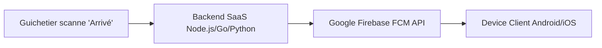

# 📡 Guide des Intégrations Externes & Déploiement SaaS
## Projet : ColisTrack Cameroun (`colis_express`)

> [!NOTE]
> L'application fonctionne actuellement en mode **Local-First & Offline-Resilient** grâce à sa base SQLite embarquée (`sqflite`) et son centre de notifications in-app et local (`flutter_local_notifications`).
> Ce document décrit les prérequis et architectures pour connecter l'application aux passerelles cloud de production.

---

## 1. Notifications Push Distantes (Firebase Cloud Messaging - FCM)

### Objectif
Notifier instantanément les clients ou chauffeurs même lorsque l'application est fermée ou en arrière-plan prolongé.

### Architecture


### Étapes de mise en service
1. **Créer un projet Firebase** sur [console.firebase.google.com](https://console.firebase.google.com).
2. **Enregistrer l'application Android** avec le package `com.example.colis_express`.
3. Télécharger le fichier `google-services.json` et le placer dans `android/app/`.
4. Ajouter dans `android/build.gradle` :
   ```groovy
   dependencies {
       classpath 'com.google.gms:google-services:4.4.2'
   }
   ```
5. Ajouter le plugin dans `pubspec.yaml` :
   ```yaml
   dependencies:
     firebase_core: ^3.10.0
     firebase_messaging: ^15.2.0
   ```
6. **Backend Cloud** : Le serveur stocke le token FCM associé au numéro de téléphone du destinataire et émet une requête HTTP v1 FCM lors du changement de statut vers `arriveDestination`.

---

## 2. SMS Transactionnels Automatiques au Cameroun

### Problématique
Au Cameroun, la majorité des destinataires n'ont pas toujours de données mobiles activées (connexion 4G désactivée pour économiser le forfait). Le **SMS classique** garantit un taux d'ouverture de 98% en moins de 3 minutes.

### Passerelles recommandées
- **Campay SMS API** (Cameroun - local) : Tarifs ~12 à 15 FCFA / SMS.
- **SMS.cm / Orange Business SMS** (Passerelle directe opérateurs locaux).
- **Twilio / Infobip** : Couverture internationale, ~25 à 35 FCFA / SMS.

### Modèle de message type
```text
TRANS-COLIS : Votre colis n° [ID] est disponible au Guichet [X] (Agence [Nom]).
Code secret de retrait : [OTP].
Présentez obligatoirement votre CNI pour le retrait.
```

---

## 3. WhatsApp Business Cloud API

### Objectif
Envoyer le bordereau de livraison électronique et le QR code de retrait directement sur WhatsApp.

### Prérequis Meta
1. Compte Meta Business Manager vérifié.
2. Numéro de téléphone dédié WhatsApp Cloud API.
3. Modèle de message pré-approuvé (Template Message) de type `Utility` :
   ```text
   Bonjour {{1}}, votre colis n° {{2}} en provenance de {{3}} est bien arrivé à l'agence {{4}}.
   Retrait au guichet {{5}} avec le code {{6}}.
   ```

---

## 4. Paiements Mobile Money Directs (Push USSD API)

### Opérateurs
1. **MTN MoMo Cameroon (Open API MoMo Developer)** :
   - Endpoint : `POST /collection/v1_0/requesttopay`
   - Déclenche instantanément le prompt USSD sur le téléphone de l'expéditeur demandant son code PIN à 4 ou 5 chiffres.
2. **Orange Money Cameroun (Orange Developer Portal)** :
   - WebPayment API / MPOS API.
3. **Agrégateurs multi-opérateurs locaux** :
   - **Campay** (supporte MTN MoMo + Orange Money avec un webhook unique).
   - **Monetbil** ou **CinetPay**.

---

## 5. Impression Thermique Bluetooth ESC/POS

### Périphérique cible
- Mini-imprimante thermique Bluetooth 58mm (ex: POS-58, GOOJPRT PT-210, MPT-II).
- Coût moyen au Cameroun : 15 000 à 25 000 FCFA.
- Intégration via le plugin Flutter `flutter_bluetooth_serial` ou `blue_thermal_printer` en transmettant les octets ESC/POS bruts (commandes `ESC @`, `ESC a 1`, etc.).
